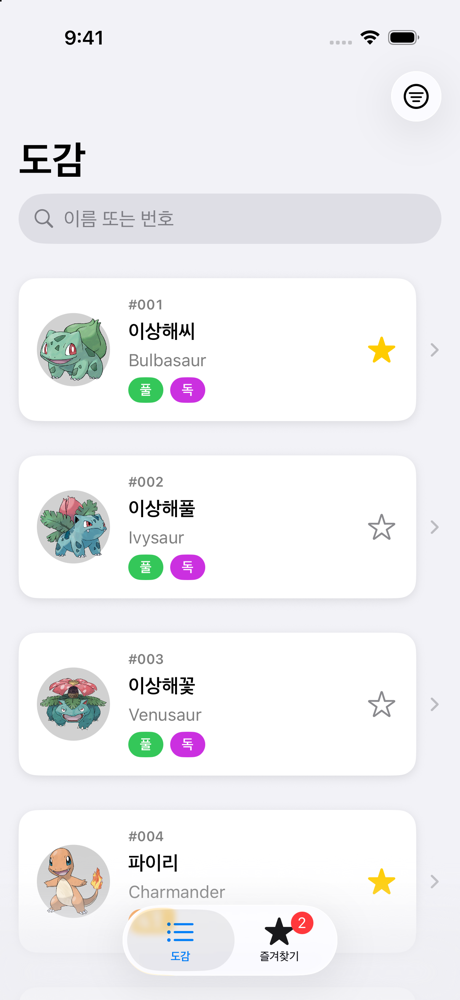
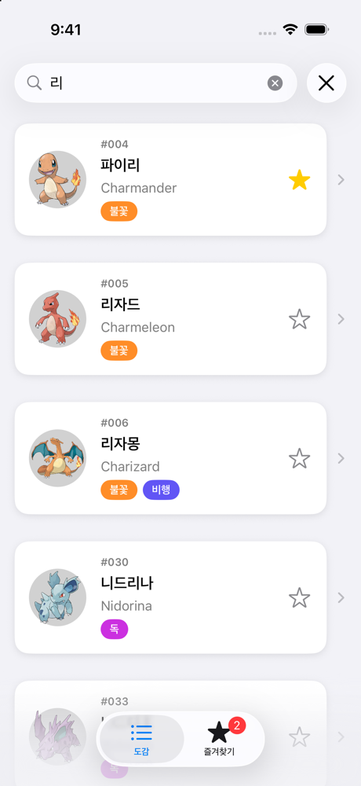
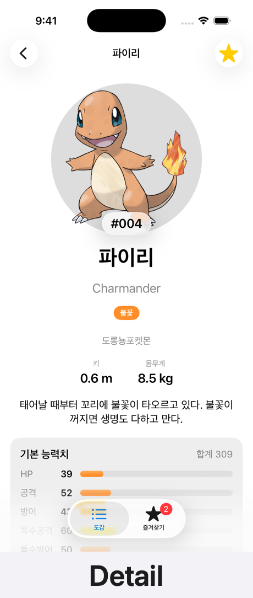
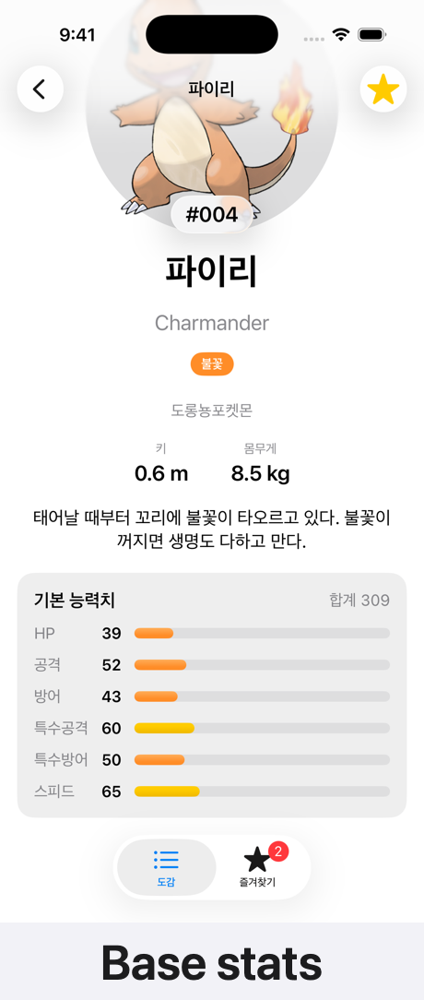
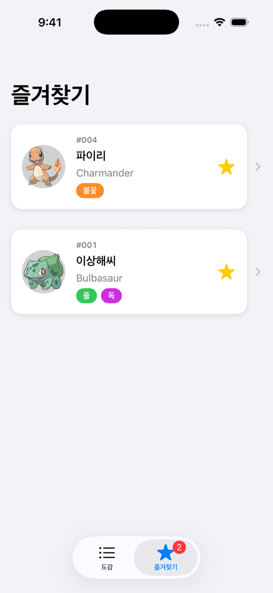

# Pokédex for iOS

A Pokédex app built with SwiftUI and modern Swift Concurrency, powered by [PokeAPI](https://pokeapi.co).
The user interface is in Korean.

<p align="center">
  
  
  
  
  
</p>

## Features

- Browse all 1,025 Pokémon with infinite scrolling and pull to refresh
- Search all 1,025 Pokémon by Korean or English name, or by number, using a bundled name list (results that are not loaded yet are fetched in pages)
- Korean names, type badges and official artwork with image caching
- Detail screen with height, weight, category, Pokédex entry and an animated base stats card
- Favorites saved on the device with SwiftData, a favorites tab and a "favorites only" filter
- Liquid Glass number badge on iOS 26, with a material fallback on iOS 17–25

## Tech stack

| Area | What is used |
|---|---|
| UI | SwiftUI, `NavigationStack`, `TabView`, `searchable`, `Grid`, animations, custom `ViewModifier` |
| State | Observation (`@Observable`), MVVM with one view model per screen, `@Environment` for shared stores |
| Concurrency | Swift 6 language mode, main actor by default, `async let`, `TaskGroup`, an `actor` cache that shares in-flight requests, `AsyncThrowingStream`, `@concurrent` JSON decoding, search debounce with `.task(id:)` cancellation |
| Persistence | SwiftData (`@Model`, `@Query`, in-memory containers for tests) |
| Networking | `URLSession` in a local Swift package (`PokeAPI`) with a small public API |
| Images | [Nuke](https://github.com/kean/Nuke) (`LazyImage`) |
| Testing | Swift Testing: parameterized tests, protocol-based fakes, gated fakes for loading-state and cancellation tests |
| Logging | `OSLog` `Logger` |

## Project structure

```
Pokedex/
├── Pokedex/                  App target
│   ├── App/                  App entry point and tab container
│   ├── Components/           Reusable views (card, type badge, image, glass badge)
│   ├── Data/                 SwiftData model, bundled Pokémon name list
│   ├── Features/
│   │   ├── List/             Pokédex screen, view model, filter sheet
│   │   ├── Detail/           Detail screen, view model, base stats card
│   │   └── Favorites/        Favorites store, button and tab
│   └── Models/               Preview sample data
├── Packages/PokeAPI/         Local Swift package: API client, response models, cache
│   ├── Sources/PokeAPI/
│   └── Tests/PokeAPITests/
├── PokedexTests/             App unit tests
├── scripts/                  Generates the bundled name list from PokeAPI data
└── docs/screenshots/
```

## Requirements

- Xcode 26 or later
- iOS 17.0 or later

## Getting started

1. Open `Pokedex.xcodeproj`.
2. Select the `Pokedex` scheme and an iPhone simulator.
3. Run with `⌘R`.

To run on a physical device, choose your own team under *Signing & Capabilities*.

## Tests

App tests (view models and the favorites store) use fakes, so they do not need the network:

```bash
xcodebuild test -scheme Pokedex -destination 'platform=iOS Simulator,name=iPhone 17'
```

Package tests run on macOS without a simulator. Some of them call PokeAPI, so they need an internet connection:

```bash
cd Packages/PokeAPI && swift test
```

## Credits

- Data and images: [PokeAPI](https://pokeapi.co) and [PokeAPI/sprites](https://github.com/PokeAPI/sprites)
- Pokémon and Pokémon character names are trademarks of Nintendo, Creatures Inc. and GAME FREAK inc. This is an unofficial, non-commercial project.

## License

The source code is available under the [MIT License](LICENSE). Pokémon data and images belong to their respective owners.
